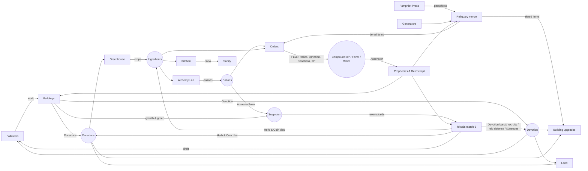

# Economy — Cult Tycoon

Owner: economy-balancer · Status: v0.1 draft. All numbers are starting points; the sim (`tools/sim/`) is the source of truth.
Real tables live in `data/balance/*.json`; this doc explains them.

## 1. Resource-flow diagram (every mode must appear here)

**Rule:** a feature that has no arrow in and out of this diagram does not ship.

## 2. Currencies & caps
| Resource | Start | Soft cap | Notes |
|---|---|---|---|
| Devotion | 50 | storage by Sermon Hall level (500/1.5k/4k/10k/25k) | overflow wasted, shown in UI |
| Donations | 20 | 300 base (Collection Plate), then Merch Tent level (1k/3k/8k/20k) | |
| Ingredients | 0 | per-crop 20 + 10/Greenhouse lvl | |
| Relics | 0 | none | meta |
| Dark Favor | 0 per entity | 100 per entity per tier | |
| Suspicion | 0 | 100 | |

## 3. Buildings (lv1 baseline, per minute, 1 average follower assigned)
| Building | Output/min | Cost (Dev/Don) | Upgrade mult (cost / output) |
|---|---|---|---|
| Sermon Hall | 6 Devotion | 0/0 (free starter) | ×2.2 cost / +60% output (additive per lvl) |
| Greenhouse | 4 plots | 30/10 | +2 plots/lvl |
| Alchemy Lab | 1 brew slot | 60/25 | +1 slot at lv3, quality +5%/lvl |
| Recruitment Booth | +1 recruit draft per 15 min | 80/20 | −2 min/lvl |
| Commune Kitchen | 1 Stew / 2 min | 100/40 | |
| Merch Tent | 3 Donations | 120/30 | +Suspicion 0.2/min at high prices |
| Pamphlet Press | 1 Pamphlet / 90s to Reliquary | 120/60 | |
| Wellness Retreat | 5 Donations, +0.4 Suspicion/min | 300/150 | |
| Ritual Circle | +10% ritual rewards, unlocks Summoning | 400/200 | |
| Dormitory | houses 4 followers (+2/lvl) | 40/15 | ×2 cost |
| Compound Wall (segment) | −15% Suspicion gain from enclosed buildings | 40/20 each | |
Follower work: each worker adds `0.5 x (0.5 + Productivity/100 + (Sanity-50) x 0.005) x (1 + trait %)` of the building's base output.
Devotion: ritual Devotion rewards x `(1 + sum(Devotion) x 0.1%)`. Doubt: Suspicion decay x `(1 - avg(Doubt) x 0.5%)`.

## 4. Crops (real-time grow, harvest yield)
| Crop | Grow | Yield | Seed cost (Don) |
|---|---|---|---|
| Suspiciously Normal Basil | 30s | 3 | 1 |
| Nightshade | 2 min | 2 | 3 |
| Moonpetal | 4 min (×0.5 at night) | 2 | 5 |
| Graveyard Moss | 3 min | 3 | 2 |
| Mandrake | 6 min | 1 | 8 |
| Wolfsbane | 8 min | 2 | 10 |
Longest timer in v1 is 8 min. Waiting is anticipation, never a gate: there's always another verb available.

## 5. Rituals rewards
Base per level: Devotion `40 + 10×levelIndex`, plus tile payouts (each Herb = 0.2 Ingredient, each Coin = 0.5 Donation, rounded).
Stars: 1★ ×1.0, 2★ ×1.25, 3★ ×1.5 (+1 Relic first time 3★). Ritual purpose bonuses: Sermon +100% Devotion; Recruitment = draft;
Raid Defense = event loss × (1 − 0.25 per star); Summoning = +20 Favor.

## 6. Orders
Reward value = Σ(item value) × 1.4 (entity) / 1.2 (outsider) / 1.1 (follower). Item value = cost of inputs + time × 2 Devotion/min.
Entity orders also give Favor (10–30) and 15% chance of a Relic. Compound XP per order = 10 + 2 × compound level (entity orders ×1.5). XP to next level: `60 × level^1.6`.
Pilgrimage Bus: 6 crates, departs every 20 min, all crates = chest (≈ 2 orders' worth).

## 7. Suspicion
`gain/min = Σ building heat + 0.02 × max(0, totalOutput/min − safeRate(level))` where `safeRate` grows with compound level.
`safeRate(level)` (combined Devotion+Donations per min): Lv1 20 · Lv2 35 · Lv3 55 · Lv4 80 · Lv5 110 · then +40/level.
Recruiting adds +6 Suspicion per new follower (+3 more if an Influencer is already in the cult). Decay: −0.5/min when gain is 0. Amnesia Brew −15, PR Sermon −10 (−20 at 3★), Wall segments as above.
Event chance per minute by band: 0 / 3% / 6% / 12%. Raid at 100.

## 8. Offline
`offline = clamp(now − lastSeenHighWater, 0, 8h)`; production at 60%; crops at 100%; no Suspicion events offline, Suspicion
decays at half rate. Negative or absurd deltas (> 30 days) are treated as 0 and logged.

## 9. Ascension & Prophecies
- Relics on ascension: `floor(5 + 2 × compoundLevel + entityQuestStepsDone + 3★count/5)`.
- Prophecies (v1, 8): purchased with Relics, **additive** bonuses with caps, e.g. *Divine Head Start* (+200 starting Devotion, max 3 ranks),
  *Green Fingers* (+10% crop yield, max 5), *Silver Tongue* (+1 recruit draft choice), *Low Profile* (−5% Suspicion gain, max 4),
  *Old Grimoire* (start with 3 known recipes), *Bigger Box* (+2 generator charges), *Ritual Muscle Memory* (+1 move per ritual, max 3),
  *Second Patron* (pledge 2 entities; unlocked by Ascension 2).
- Cap total production bonus from Prophecies at +100% (additive). No compounding multipliers in v1 (D-106).

## 9.5 Open balance risks to watch in the first sim
- Sermon Hall at 6 Devotion/min may make Lv1–2 feel slow; rituals should carry early Devotion. Target: first 10 minutes ≈ 60% ritual-sourced.
- Offline 60% plus Suspicion-free offline time could make idle-only dominant past Lv6. Check the idle-only strategy's time to Lv10.
- Anansi's dice must have **higher mean, bounded variance** (floor 50% of base), or bad luck will feel like a stall.

## 10. Simulation (`npm run sim`)
Headless, deterministic, uses `src/core`. Strategies: *greedy-builder*, *puzzle-heavy*, *idle-only (check-in every 2h)*, *random*.
Reports per run: time to each compound level, resource curves (CSV + ASCII chart), stall points, Suspicion band time, ascension timing.
**Fails CI-style** if:
- any strategy goes **> 10 min active play** without a new unlock in days 1–7,
- one **active** action type (build, upgrade, order, ritual, brew, merge, recruit) accounts for **> 60%** of value gained in any 30-minute window (passive collection excluded; D-116),
- run 2 or 3 is not at least 25% faster to Lv10 than run 1, or more than 70% faster (prestige too weak / too strong),
- any resource grows faster than quadratic over 3 ascensions (inflation check).
Required horizon: first 7 in-game days and 3 ascensions.
